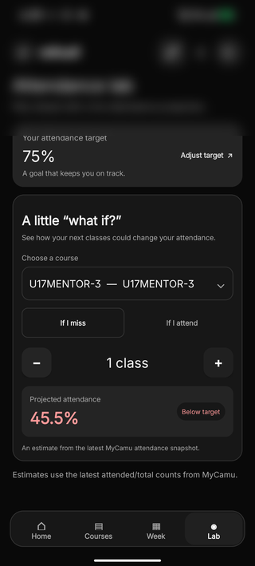

# Rollcall V1

Hey! I made Rollcall because I kept asking myself: **“Can I skip this class and still stay above 75%?”** 😅

I wanted a quick way to check my attendance and stop guessing. Then I added my timetable, a little *what if?* calculator, themes, reminders… and suddenly this was a whole app. I’m still making it mostly for myself, but figured other students might find it handy too. Hope it helps you stay on track (and make it to class sometimes 😭).

## Getting started

1. Download **[Rollcall V1 for Android](https://github.com/inianexe/Rollcall/releases/tag/v1.0.0)** from the release assets.
2. Open it and follow Android’s install prompts.
3. Open Rollcall and tap **Continue with MyCamu**.
4. Sign in with your usual account.
5. Once you’re signed in, you’ll land on the dashboard. Pick a theme and make yourself at home 🎨

If you close the app before finishing sign-in, just open it again and tap **Continue with MyCamu**.\n\n**Already installed the earlier V1 preview?** The new release signature cannot update over that debug-signed copy. Uninstall the old preview, then install this one. Uninstalling clears Rollcall’s locally saved data, so you’ll need to sign in and sync again.

## What’s where?

**Home** — your overall attendance, courses that need attention, next class, and the latest class update. Tap the latest class to open your attendance history.

**Courses** — search for a subject and see your attendance, target, and how many classes you need to attend. Tap **What If** on a course to try out “what if I attend?” or “what if I miss?” without changing your real attendance.

**Week** — your timetable, day by day. Tap a day to see its classes. Switch to **Attendance** for the class history.

**Lab** — pick a course, choose **If I miss** or **If I attend**, then change the class count. It’ll estimate your new percentage. Nothing gets changed in your actual record.

**Themes** — after sign-in, tap the paintbrush for colors or the moon/sun to switch dark and light. Your choice sticks around.

**Reminders** — turn on class reminders in Week if you want a heads-up before class. Android may ask to allow notifications.

## If Chrome or Android blocks the install

The APK is signed with Rollcall’s dedicated release key, but it is still distributed outside Google Play, so Chrome or Android may show extra warnings. Only use the [Rollcall GitHub release](https://github.com/inianexe/Rollcall/releases/tag/v1.0.0), check that the file is named **Rollcall-V1.apk**, and keep Chrome Safe Browsing and Play Protect turned on.

### Chrome says the file may be dangerous or blocks the download

Chrome’s Safe Browsing setting lives under **⋮ → Settings → Privacy and security → Safe Browsing**. It can warn about an APK because it is uncommon or not yet recognized. That warning is a real security check, not proof that a file is safe or unsafe. Google’s [Chrome download help](https://support.google.com/chrome/answer/6261569) explains the warning types.

- First, make sure the address is the official GitHub release above. Don’t install an APK from an ad, mirror, message, or lookalike URL.
- If Chrome offers a scan, choose **Scan**. If it only shows an unfamiliar-file warning and you’ve confirmed the release and filename, you can decide whether to keep the download.
- If Chrome says the file is dangerous, the download is blocked by your school/work administrator, or there is no option to continue, stop. Don’t switch Safe Browsing off to force it. Try again later or ask your administrator if the device is managed.

### Android says “For your security, your phone isn’t allowed to install unknown apps”

Allow the app that downloaded the APK (usually Chrome or Files) to install it:

1. Tap **Settings** on the warning, or open **Settings → Apps → Special app access → Install unknown apps**.
2. Choose **Chrome** or **Files**—whichever you used to open the APK.
3. Turn on **Allow from this source**, return to the APK, and tap **Install**.
4. Afterward, turn **Allow from this source** off again.

The menu names can vary a bit by phone. Google has [steps for installing apps from other sources](https://support.google.com/pixelphone/answer/7391672).

### Play Protect says Rollcall is unknown, unverified, or potentially harmful

Play Protect checks apps installed outside Google Play, and some phones may block an unverified app entirely. You can ask Play Protect to scan the APK first. If Android gives you an **Install anyway** option and you have verified that you downloaded this exact release, it’s your choice whether to proceed. Keep Play Protect on. If Android says installation is blocked and offers no supported continue option, stop; don’t turn Play Protect off or try to bypass the device’s block. See [Google’s Play Protect help](https://support.google.com/android/answer/2812853).

Some devices and regions also enforce Android developer verification for sideloaded apps. If you see a separate **developer isn’t verified** block, follow only the official Android flow shown on your phone. If it offers no way to continue, this GitHub preview may not install on that device yet. [Android developer verification details](https://support.google.com/android/answer/17065026).

### Samsung Galaxy says Auto Blocker stopped the install

Auto Blocker can stop apps installed outside Google Play or Galaxy Store. Check **Settings → Security and privacy → Auto Blocker**. If you choose to install Rollcall, turn it off only long enough to install the APK from the official release, then turn it back on. Samsung’s [Auto Blocker guide](https://www.samsung.com/us/support/answer/ANS10003636/) has more detail.

### It says “App not installed” or the download won’t open

- Delete the incomplete download and download **Rollcall-V1.apk** again from the release page.
- Check that your phone has free storage, then restart the phone and try again.
- If an older Rollcall preview is already installed, Android may reject this APK if that copy was signed differently. Uninstalling the old copy can fix that, but it also deletes Rollcall’s saved data on that phone—only do this if you’re okay losing it.
- If the message says the device is managed or installation is disabled by an administrator, only that administrator can change the policy. Don’t try to work around a school/work restriction.

The release includes a SHA-256 checksum file beside the APK for anyone who wants to verify the downloaded file before installing.\n\nThe release signing certificate’s SHA-256 fingerprint is `19117b6b5320c6adb907834880f031d00040e0a3114a9a8d3633539349bf1bc6`. This identifies the signing key used for continuity; it is not a Google Play review or endorsement.

## A couple things to know

Sometimes the portal doesn’t give enough detail to match an attendance record to a specific class. Rollcall will show **Unable to confirm** instead of making something up. For anything important, double-check your student portal.

Updates can take a while in the background, depending on Android. Open Rollcall and sync when you need the latest info.

## Screenshots

Here’s what the main screens look like in monochrome mode:

| Home | Week | Courses | Lab |
|:---:|:---:|:---:|:---:|
|  |  |  |  |

If Rollcall’s useful to you, a ⭐ on the repo would make my day — and help other students find it too!

Rollcall is an independent project. It isn’t affiliated with MyCamu or any school.
