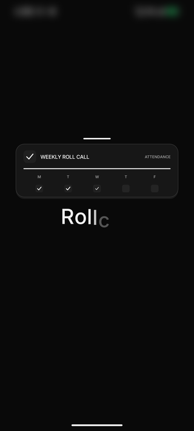
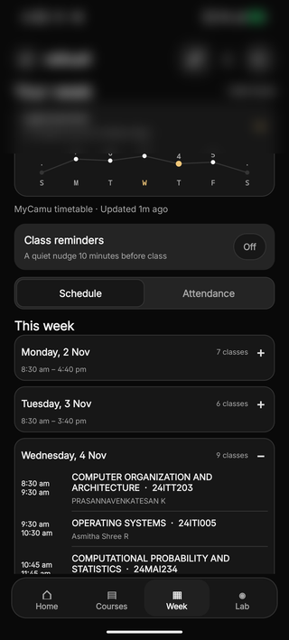
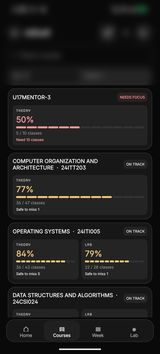

# Rollcall for Android

Okay, real talk: I started Rollcall for a very student reason 😅 I kept wondering, “If I skip one more class, am I still safe?” So I made a tiny attendance calculator for myself. Then it got a timetable, a What If button, themes, reminders… and somehow became a whole app. I’m still building it for fun (and to help myself actually make it to class 😭). If it helps you too, that’s a win! 🎒✨

## Get started

1. Download **Rollcall V1.apk** from this repository.
2. Open the download and follow Android’s install prompts.
3. Open Rollcall and tap **Continue with MyCamu**.
4. Sign in on the MyCamu page using your existing account.
5. Once sign-in is complete, Rollcall opens your dashboard. Choose your look from the theme controls there.

If you leave before signing in, open Rollcall again and tap **Continue with MyCamu** to resume.

## Find your way around

### Home
See your overall attendance, the courses that need attention, the next class, and the latest class update. Tap the latest class card to open your attendance history.

### Courses
Browse or search your subjects. Each course shows attended classes, your current percentage, and how many classes you need to attend to reach your goal. Open a course’s **What If** planner to see how attending or missing classes could change its percentage.

### Week
Check the weekly class rhythm and expand a day to see its timetable. Switch to **Attendance** to browse class records by day.

### Lab
Choose a course, select **If I miss** or **If I attend**, and adjust the number of classes. Rollcall shows the estimated result; your actual attendance is never changed.

### Make it yours
After sign-in, use the paintbrush to choose a color theme and the moon or sun control to change dark or light mode. Your choices stay selected when you reopen the app.

## Reminders and updates

Turn on **Class reminders** in Week if you want a nudge before class. Android may ask whether Rollcall can send notifications. Background updates can be delayed by Android, so open the app and sync when you need the latest information.

## A note about attendance records

Rollcall shows **Present**, **Absent**, or **Unable to confirm** based on records it can match to a course and class time. If a record is unclear, it stays unconfirmed instead of guessing. Compare important attendance decisions with your student portal.

## Screenshots

These compact screenshots show the app’s main screens. Student identity details are obscured.

| Home | Week | Courses |
|:---:|:---:|:---:|
|  |  |  |

If Play Protect shows a warning, check that you downloaded the APK from this Rollcall repository. On the warning screen, choose **More details** and then **Install anyway** if Android offers that option. You can also ask Play Protect to scan the app first. Keep Play Protect enabled; if Android does not offer an install option, stop and contact us rather than changing phone security settings.

Rollcall is an independent project and is not affiliated with MyCamu or any institution.
