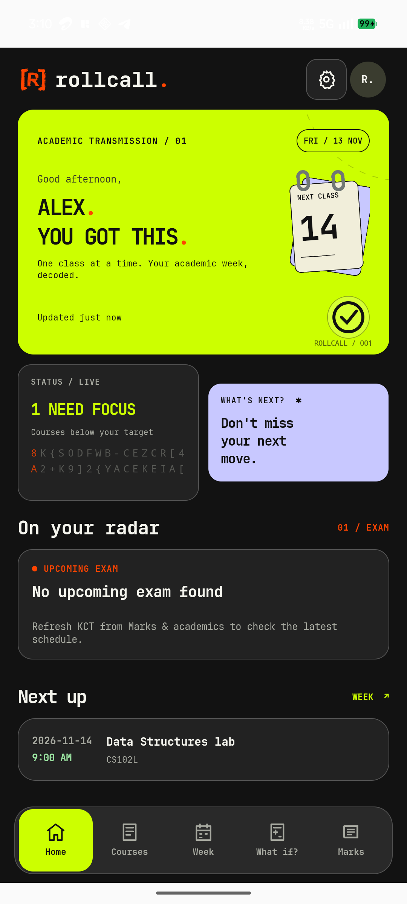
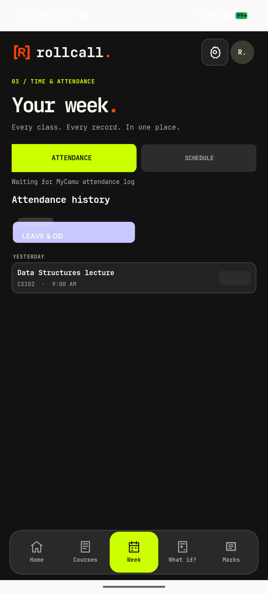
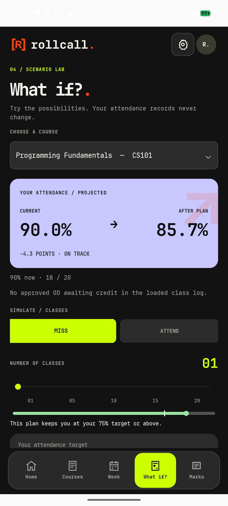
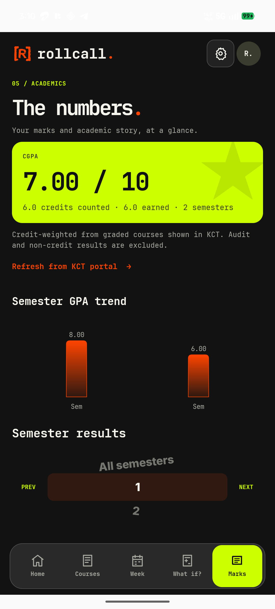

# RollCall UI refinement and internal-marks audit

Baseline: Java Torch dashboard at `3f1377d`, reviewed 2026-11-14. Existing production app version 26 is installed on the connected A001 phone. QA must use a separate `.qa` application ID; do not replace the installed app.

## Changes and verification

| Area | Change | Verification |
|---|---|---|
| Week → Attendance | Removed the floating folder control and added a full-width “Leave & OD” route to the existing history/filter screen. | Physical-phone instrumentation passed route, Back, and current-semester/All OD filter assertions. |
| Home status | Removed random changing characters from the live status area; status and timestamp remain readable. | Physical-phone instrumentation passed the settled headline, status text, and absence of the glitch view. |
| What If | Removed the decorative projection arrow; retained the attendance projection and class-count control with clearer labels. | Physical-phone instrumentation passed the rendered projection/action assertions; manual slider min/max exploration remains unverified. |
| Navigation/scrolling | Added 32dp lower scroll clearance and simplified the empty next-class summary. | Physical-phone navigation instrumentation passed. Manual scroll-to-bottom and gesture-inset inspection remains unverified. |
| Appearance | Added Light/Dark/System appearance and five selectable palettes on Android and web, with Signal still the default. | Android contrast unit tests and browser spot checks across Signal, Cobalt, and Copper passed. Phone instrumentation rendered dark and light dashboard fixtures. Preference persistence was not manually explored. |
| Internal assessments | Added a separate validated model, optional snapshot field, empty state, and web/Android rendering. Scores appear only for valid published rows. Existing semester results and GPA calculation paths remain separate. | Android model and physical-phone empty-state assertions passed; web snapshot tests passed. Live KCT source/authenticated integration: unavailable and intentionally not claimed. |

## Data-source constraint

KCT's public [Digital Campus page](https://kct.ac.in/digital-campus/) lists Internal Marks and End Semester Results in its KITE student ERP. This establishes that the institution offers an internal-marks feature; it does not establish a student-authorized API, supported export, or that the current `portal.kct.ac.in` session can read those records. No marks are fabricated. The UI remains explicitly empty until an authorized supported source is verified.

## Visual references

The committed baseline references are sanitized fixtures and are retained for comparison:

## Remaining checks

- Check web layouts at narrow phone width and desktop breakpoints in a browser.
- Manually scroll the Android dashboard to the last item and inspect gesture insets; instrumentation verified navigation but did not measure those touch boundaries.

The temporary `com.iniexe.rollcall.qa` package was removed after testing. The production `com.iniexe.rollcall` package remains installed at version code 26.
